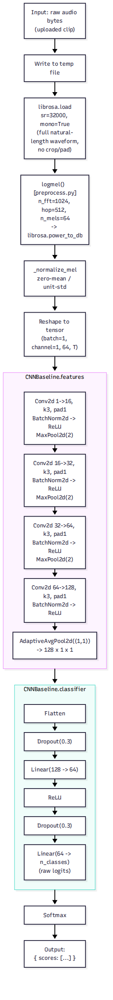

# CNN Inference Pipeline — Step by Step

This explains [`DOC-ARCH-001-cnn-inference-pipeline-step-by-step.mmd`](../diagrams/DOC-ARCH-001-cnn-inference-pipeline-step-by-step.mmd) / [`DOC-ARCH-001-cnn-inference-pipeline-step-by-step.png`](../diagrams/DOC-ARCH-001-cnn-inference-pipeline-step-by-step.png), the detailed, layer-by-layer path a single audio clip takes through `CNNBaseline.run()` (see [`models/cnn.py`](../../src/carol_anne/models/cnn.py)) — from raw uploaded bytes to a final probability for each class.



If you're new to CNNs, read this like a recipe: each stage takes the output of the one before it and reshapes or refines it a little further, until "a sound" has become "a set of percentages."

---

## 1. Input: raw audio bytes → temp file

The API hands the model a blob of raw bytes — literally the uploaded file's contents, no different from what you'd get opening the `.wav`/`.mp3` in a hex editor. The model writes those bytes to a temporary file on disk because the audio-decoding library (`librosa`) expects a file path, not an in-memory blob.

**Think of it like:** dropping off a sealed package (the bytes) at a desk so the mailroom (librosa) can open it properly, rather than trying to read the contents through the envelope.

## 2. `librosa.load` — decoding the waveform

```
sr=32000, mono=True
```

This decodes the compressed audio into a plain list of numbers — a **waveform**: one number per sample, 32,000 samples per second, representing air pressure at that instant. `mono=True` collapses stereo down to a single channel.

**Visualize it as:** a zoomed-in EKG line —

```
amplitude
  1.0 |        .-.
      |      .'   '.        .-.
  0.0 |----'---------'------'---'----------> time
      |                              .-.
 -1.0 |                            .'   '.
```

Crucially, the CNN's inference path uses the clip's **full, natural length** here — no cropping to a fixed window like training does (more on that in the training diagrams). A 2-second clip and a 15-second clip both flow through unmodified.

## 3. `logmel()` — turning sound into a picture

Defined in [`preprocess.py`](../../src/carol_anne/preprocess.py): a mel spectrogram (`n_fft=1024`, `hop=512`, `n_mels=64`) converted to decibels via `librosa.power_to_db`.

A CNN is built for *images* (2D grids of numbers), not 1D waveforms. So this step re-expresses "loudness over time" as "loudness per frequency band, over time" — a 2D grid, exactly like a photograph, where one axis is time and the other is pitch.

**Mock spectrogram** (`█` = loud, `░` = quiet) — this is what the model actually "sees":

```
high pitch  ░░░▒▒░░░░░░▓▓▓░░░░░░░░▒▒░░░░
            ░░▓▓▓▓░░░░▓███▓░░░░░░▓▓▓▓░░░
            ▒▓████▓░░▓█████▓░░░░▓████▓░░
            ▓██████▓▓███████▓░░███████▓
low pitch   ▓██████████████████████████
            └──────────── time ────────►
```

## 4. `_normalize_mel` — zero-mean / unit-std

Every clip's spectrogram is rescaled so its own values average to 0 with a standard deviation of 1. Without this, a clip recorded quietly (small numbers) and one recorded loudly (large numbers) would look completely different to the model even if they contain the exact same *pattern* of sound.

**Think of it like:** adjusting brightness/contrast on a photo so two pictures of the same object — one taken in dim light, one in bright light — end up looking comparably exposed.

## 5. Reshape to tensor `(batch=1, channel=1, 64, T)`

PyTorch models expect input shaped `(batch, channel, height, width)`. The spectrogram becomes:
- **batch = 1** — one clip in this request
- **channel = 1** — grayscale image, not RGB
- **64** — number of mel frequency bins (the image's "height")
- **T** — number of time frames (the image's "width"), which **varies per clip** since it is never cropped

This variable `T` is the whole reason the next stage needs `AdaptiveAvgPool2d` — a normal CNN classifier would break on inputs of different sizes.

## 6. `CNNBaseline.features` — finding patterns

Four convolutional blocks, each learning to recognize progressively more abstract shapes in the spectrogram image:

```
Block 1: Conv(1→16)  → BatchNorm → ReLU → MaxPool(2)   [64×T → 32×T/2]
Block 2: Conv(16→32) → BatchNorm → ReLU → MaxPool(2)   [32×T/2 → 16×T/4]
Block 3: Conv(32→64) → BatchNorm → ReLU → MaxPool(2)   [16×T/4 → 8×T/8]
Block 4: Conv(64→128)→ BatchNorm → ReLU                [8×T/8, no shrink]
         AdaptiveAvgPool2d((1,1))                       → 128×1×1
```

**Convolution**, in plain terms: a small window (say 3×3 pixels) slides across the spectrogram, and at every position it computes "how much does the pattern under me look like a pattern I've learned to detect?" (an edge, a rising pitch, a burst of energy). Stack enough of these and later layers detect whole *combinations* of earlier patterns.

```
  spectrogram          3x3 filter slides across
  ┌─┬─┬─┬─┬─┐          ┌─┬─┐
  ├─┼─┼─┼─┼─┤          │▓│▓│  → "does this patch match
  ├─┼─┼─┼─┼─┤   ────►  ├─┼─┤    the pattern I detect?"
  ├─┼─┼─┼─┼─┤          │▓│▓│
  └─┴─┴─┴─┴─┘          └─┴─┘
```

**MaxPool** shrinks the image by keeping only the strongest signal in each small neighborhood — like zooming a photo out while keeping only the brightest pixel of each cluster, so the important stuff survives and the image gets smaller (and cheaper to process) each block.

**`AdaptiveAvgPool2d((1,1))`** is the key trick that makes variable-length audio work at all: no matter how wide the spectrogram was (`T` could be small or huge), this squashes every channel's entire remaining grid down to a *single average number*. The output is always exactly `128` numbers — one per channel — regardless of the input clip's duration.

## 7. `CNNBaseline.classifier` — making a decision

```
Flatten → Dropout(0.3) → Linear(128→64) → ReLU → Dropout(0.3) → Linear(64→n_classes)
```

The 128 summary numbers from the feature extractor get passed through two small fully-connected layers that combine them into one raw score per class ("logits"). `Dropout` randomly zeroes out some numbers *during training only*, which discourages the network from over-relying on any single feature — it has no effect at inference time.

**Think of it like:** a small committee that takes 128 expert opinions (the summarized features) and boils them down to one confidence score per candidate class.

## 8. Softmax → Output

Raw logits aren't probabilities — they can be any real number, positive or negative. Softmax converts them into values between 0 and 1 that sum to 100%.

**Mock output** for a hypothetical clip:

```
Class01   ██████████████████ 72%
Class02   ███████            18%
Class03   ██                  6%
Class04   █                   4%
```

The final result is `{"scores": [...]}` — one probability per class, in the order of `LABELS`. The [overview diagram](DOC-ARCH-002-cnn-inference-pipeline-overview.md) shows how those scores become the API response.

---

**Related:** [`DOC-ARCH-002-cnn-inference-pipeline-overview.md`](DOC-ARCH-002-cnn-inference-pipeline-overview.md) zooms out to show this whole diagram as a single "CNN Model" box inside the full API request/response lifecycle.
