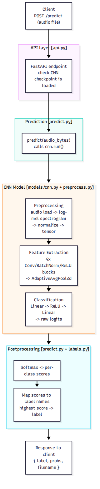

# CNN Inference Pipeline — The Broad Picture

This explains [`DOC-ARCH-002-cnn-inference-pipeline-overview.mmd`](../diagrams/DOC-ARCH-002-cnn-inference-pipeline-overview.mmd) / [`DOC-ARCH-002-cnn-inference-pipeline-overview.png`](../diagrams/DOC-ARCH-002-cnn-inference-pipeline-overview.png) — the *whole request lifecycle*, zoomed out. Where [`DOC-ARCH-001-cnn-inference-pipeline-step-by-step.md`](DOC-ARCH-001-cnn-inference-pipeline-step-by-step.md) shows every layer inside the model, this one shows how a prediction request travels through the *system* the model lives in: the API, the prediction call, the model, and the response.



**A helpful mental model:** think of this like ordering food at a restaurant. You (the client) place an order; a waiter takes it to the kitchen; the chef cooks the dish; it gets plated and garnished; then it's served back to you. Nobody at the table needs to know how the stove works — that's `DOC-ARCH-001-cnn-inference-pipeline-step-by-step.md`'s job.

---

## 1. Client — `POST /predict`

Someone (a user, a script, a test) uploads an audio file to the API. This is the "customer places an order" step — all the client provides is the file.

## 2. API layer — [`api.py`](../../src/carol_anne/api.py)

The FastAPI endpoint receives the upload and checks that the CNN checkpoint is loaded before doing any real work. If it isn't, the request is refused with a `503` instead of failing halfway through.

**Think of it like:** the waiter checking the kitchen is open before walking the order back.

## 3. Prediction — [`predict.py`](../../src/carol_anne/predict.py)

`predict()` passes the audio bytes straight to the CNN's `run()` method. There is one model, so there is nothing to route.

## 4. CNN Model — grouped

This box is the *entire* [`DOC-ARCH-001-cnn-inference-pipeline-step-by-step.md`](DOC-ARCH-001-cnn-inference-pipeline-step-by-step.md) diagram, collapsed down to three phases so the big picture doesn't get lost in layer-by-layer detail:

- **Preprocessing** — audio → log-mel spectrogram → normalized tensor
- **Feature Extraction** — the four conv/pool blocks that turn a spectrogram into 128 summary numbers
- **Classification** — the small decision-making layers that turn those numbers into per-class logits

If you want the full breakdown of any of these three, that's exactly what the other diagram is for — this one deliberately hides that complexity to keep the request flow readable.

## 5. Postprocessing — [`predict.py`](../../src/carol_anne/predict.py) + [`labels.py`](../../src/carol_anne/labels.py)

Two small steps happen *after* the model itself is done:

1. **Softmax** turns raw logits into percentages (see `DOC-ARCH-001-cnn-inference-pipeline-step-by-step.md` §8)
2. **Label mapping** pairs each percentage with a human-readable class name (`"Class01"`, `"Class02"`, etc.) instead of a bare index, and the highest one becomes the `label`

## 6. Response to client

```json
{
  "label": "Class01",
  "probs": {"Class01": 0.91, "Class02": 0.04, "Class03": 0.02, "...": "..."},
  "filename": "clip.mp3"
}
```

**Mock timeline** of where time is typically spent in a request like this (illustrative, not measured):

```
Upload/decode   ▓▓░░░░░░░░░░░░░░░░░░  fast
Preprocessing   ▓▓▓░░░░░░░░░░░░░░░░░  fast
Model forward   ▓▓▓▓▓▓▓▓▓▓▓░░░░░░░░░  the heavy part
Postprocessing  ▓░░░░░░░░░░░░░░░░░░░  negligible
```

---

**Related:** [`DOC-ARCH-001-cnn-inference-pipeline-step-by-step.md`](DOC-ARCH-001-cnn-inference-pipeline-step-by-step.md) expands the "CNN Model" box above into every individual layer. [`DOC-ARCH-004-cnn-training-pipeline-overview.md`](DOC-ARCH-004-cnn-training-pipeline-overview.md) covers how that model was *produced* in the first place, before it was ever available to serve a request like this one.
