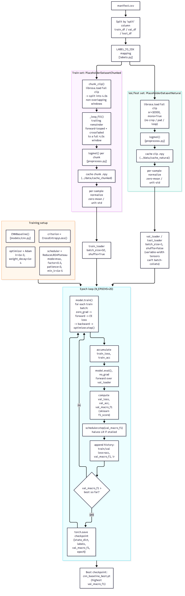

# CNN Training Pipeline — Step by Step

This explains [`DOC-ARCH-003-cnn-training-pipeline-step-by-step.mmd`](../diagrams/DOC-ARCH-003-cnn-training-pipeline-step-by-step.mmd) / [`DOC-ARCH-003-cnn-training-pipeline-step-by-step.png`](../diagrams/DOC-ARCH-003-cnn-training-pipeline-step-by-step.png) — the detailed path data takes to *produce* `cnn_baseline_best.pt`, the checkpoint that [`DOC-ARCH-001-cnn-inference-pipeline-step-by-step.md`](DOC-ARCH-001-cnn-inference-pipeline-step-by-step.md) later loads to serve real predictions. Sourced from [`notebooks/cjk-CNN-model-1.ipynb`](../../notebooks/cjk-CNN-model-1.ipynb), which trains the same `CNNBaseline` class and `logmel()`/`load_clip()` functions the deployed API uses.



**A helpful mental model throughout:** training a model is like coaching an athlete for a season. You need practice drills (training data), occasional scrimmages to see how they're really doing (validation), a season-long practice schedule (epochs), and you only keep the personal-best performance on record (checkpointing) — not just whatever happened on the very last day.

---

## 1. `manifest.csv` → train / val / test split

A spreadsheet listing every clip's file path and label gets split into three groups by a `split` column set up ahead of time:

```
train_df   ──► clips the model is allowed to learn from
val_df     ──► clips used to check progress during training (never trained on)
test_df    ──► clips held back entirely, scored only once, at the very end
```

**Think of it like:** study material (train) vs. a practice quiz you check yourself against every week (val) vs. the final exam you only see once, after all studying is done (test). If the model ever "saw" test data during training, its exam score would be meaningless — it would just be regurgitating memorized answers.

## 2. Two different data pipelines — and why

This is the most important design decision in the whole training process, so it gets its own comparison:

| | **Training pipeline** | **Val/Test pipeline** |
|---|---|---|
| Python class | `PlaceholderDatasetChunked` | `PlaceholderDatasetNatural` |
| Clip length | Forced to a fixed 4.0s window | Full, natural, untouched length |
| Short clips | Loop-filled to reach 4.0s | Left as-is |
| Long clips | Split into multiple 4.0s chunks (more training examples!) | Used whole, as one example |
| Why | Fixed size → can batch many clips together efficiently | Must match exactly what a real deployed request looks like |

### `chunk_clip()` + `_loop_fill()`

A clip longer than 4 seconds is cut into consecutive, non-overlapping 4-second windows — like slicing a long recording into flashcards. If the final slice is too short, instead of padding it with silence (which would teach the model "silence" incorrectly), the audio is **looped back on itself** with a short crossfade so the seam is inaudible:

```
original clip (leftover 1.5s):  [~~~~~~]
looped + crossfaded to 4.0s:    [~~~~~~|~~fade~~|~~~~~~]
                                  real    blend    repeated
```

**Why not just pad with silence?** A model trained on padded silence learns to associate "silence" with whatever label that clip has — actively wrong. Looping keeps every sample of every training window *real audio*.

## 3. `logmel()` + caching — same as inference

Both pipelines call the exact same [`logmel()`](../../src/carol_anne/preprocess.py) function described in `DOC-ARCH-001-cnn-inference-pipeline-step-by-step.md` §3 — turning the waveform into a mel spectrogram image. Results are cached to `.npy` files on disk (`cache_chunked/` and `cache_natural/`) so re-running training doesn't re-decode and re-transform every clip from scratch each time.

**Think of it like:** doing your homework once and keeping the notes, instead of re-reading the entire textbook every single day.

## 4. Per-sample normalize

Same zero-mean/unit-std trick as inference (`DOC-ARCH-001-cnn-inference-pipeline-step-by-step.md` §4) — each spectrogram is independently rescaled so loud and quiet recordings are judged on their *pattern*, not their raw volume.

## 5. DataLoaders — why the batch sizes differ

```
train_loader:        batch_size=32, shuffle=True
val_loader/test_loader: batch_size=1,  shuffle=False
```

Training chunks are all exactly 4.0 seconds, so 32 of them can be stacked into one neat rectangular batch tensor. Val/test clips are each a *different* natural length — you can't stack a 3-second spectrogram and a 12-second spectrogram into the same box, so those go through one at a time. `shuffle=True` on training mixes up the order every epoch (like shuffling flashcards) so the model doesn't accidentally learn "clip #1 is always followed by clip #2."

## 6. Training setup

```
model      = CNNBaseline()                          — the same architecture from DOC-ARCH-001-cnn-inference-pipeline-step-by-step.md
criterion  = CrossEntropyLoss()                      — the scorekeeper
optimizer  = Adam(lr=1e-3, weight_decay=1e-4)        — the hiker adjusting step size
scheduler  = ReduceLROnPlateau(mode=max, factor=0.5, patience=3, min_lr=1e-5)
```

- **CrossEntropyLoss** measures how wrong a prediction was — and punishes *confident* wrong answers (95% sure it's Class01, but it was Class02) far more than *unsure* wrong answers.
- **Adam** is the algorithm that nudges every weight in the network a little bit after each batch, in the direction that would have reduced the loss. Think of a hiker feeling the slope of the ground underfoot and taking a step downhill toward the valley (lowest loss) — Adam is just a smart way of picking how big that step should be.
- **ReduceLROnPlateau** watches `val_macro_f1` (the validation score), and if it stops improving for 3 epochs in a row, it cuts the step size in half — like slowing down as you get close to your destination, to avoid overshooting.

## 7. The epoch loop (20 epochs)

One **epoch** = one full pass through every training example. Each epoch has two phases:

**Train phase** (`model.train()`): for every batch — predict, measure loss, compute gradients (`backward()`), update weights (`optimizer.step()`). This is the only phase where the model actually *learns*.

**Validation phase** (`model.eval()`, `no_grad`): run the current model over `val_loader` *without* updating any weights — just to measure `val_loss`, `val_acc`, and `val_macro_f1`. This is the "practice quiz" — it tells you how you're doing without letting you study off the answer key.

After each epoch: the scheduler checks whether to shrink the learning rate, the epoch's stats are appended to a `history` dict (used later to plot training curves), and — **only if this epoch's `val_macro_f1` beats every previous epoch's** — the model's weights are saved to `cnn_baseline_best.pt`.

**Mock training curve** — a typical shape, illustrative only:

```
Loss
1.8 |*
1.5 |  *
1.2 |    *   *
0.9 |         *    *
0.6 |              *     *   *
0.3 |                        *    *   *
    +----------------------------------------
     1   3   5   7   9   11  13  15  17  19  epoch

       ── train_loss    (keeps dropping — model memorizing training data)
       - -  val_loss    (drops, then flattens — real generalization limit)
```

**Why checkpoint on the *best* epoch instead of the *last* one?** Training loss almost always keeps falling the longer you train, even after the model has started overfitting (memorizing training quirks instead of learning general patterns). Validation score is the more honest signal, so only improvements *there* get saved — the final epoch isn't necessarily the best one.

## 8. Best checkpoint

`cnn_baseline_best.pt` stores the winning epoch's `state_dict` (all the learned weights), the label list, its `val_macro_f1`, and which epoch produced it. This is the exact file [`DOC-ARCH-001-cnn-inference-pipeline-step-by-step.md`](DOC-ARCH-001-cnn-inference-pipeline-step-by-step.md) loads at inference time.

---

**Related:** [`DOC-ARCH-004-cnn-training-pipeline-overview.md`](DOC-ARCH-004-cnn-training-pipeline-overview.md) collapses all of the above into five broad phases. [`DOC-ARCH-001-cnn-inference-pipeline-step-by-step.md`](DOC-ARCH-001-cnn-inference-pipeline-step-by-step.md) shows what happens *after* training, when this checkpoint gets used to answer real requests.
