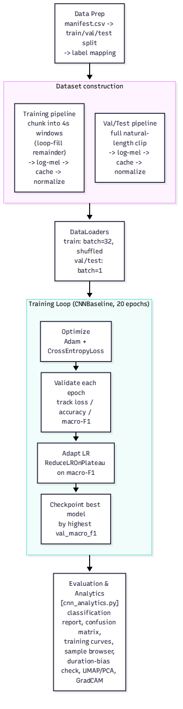

# CNN Training Pipeline — The Broad Picture

This explains [`DOC-ARCH-004-cnn-training-pipeline-overview.mmd`](../diagrams/DOC-ARCH-004-cnn-training-pipeline-overview.mmd) / [`DOC-ARCH-004-cnn-training-pipeline-overview.png`](../diagrams/DOC-ARCH-004-cnn-training-pipeline-overview.png) — the five-phase, zoomed-out version of how `cnn_baseline_best.pt` gets made. For the full mechanics of any phase (loop-fill crossfading, the exact epoch loop, checkpoint logic), see [`DOC-ARCH-003-cnn-training-pipeline-step-by-step.md`](DOC-ARCH-003-cnn-training-pipeline-step-by-step.md).



**A helpful mental model:** this is a coaching season, top to bottom — organize the practice materials, design the drills, schedule the practice sessions, run the season of practice-and-feedback, then review the game film afterward.

---

## 1. Data Prep

`manifest.csv` gets split into train/val/test groups, and each class name (`"Class01"`, `"Class02"`, ...) is mapped to a numeric index the model can output a score for. This is the "sort the playbook and roster" step — nothing audio-specific happens yet, just organizing what belongs where.

## 2. Dataset construction — two parallel pipelines

```
Training pipeline:    chunk into fixed 4s windows (loop-fill short clips)
                       → log-mel spectrogram → cache → normalize

Val/Test pipeline:    keep each clip's full natural length
                       → log-mel spectrogram → cache → normalize
```

These run side by side because they serve different purposes: training needs **uniform, efficient batches** (so clips get force-fit to a consistent size), while validation and testing need to **honestly reflect what a real deployed request looks like** (so clips are left exactly as a user would upload them). See `DOC-ARCH-003-cnn-training-pipeline-step-by-step.md` §2 for the full reasoning and a side-by-side comparison table.

**Mock comparison** of what a training example vs. a val example actually contains:

```
Training example (4.0s, always):    [■■■■■■■■■■■■■■■■]  ← same width every time
Val/test example (varies):          [■■■■■]              ← short clip
                                     [■■■■■■■■■■■■■■■■■■■■■■■]  ← long clip
```

## 3. DataLoaders

Training clips (all a uniform 4.0s) get batched 32-at-a-time and shuffled every epoch. Val/test clips (each a different natural length) go through one at a time, since they can't be stacked into a single rectangular batch.

## 4. Training Loop — `CNNBaseline`, 20 epochs

Four things happen together, repeated once per epoch:

- **Optimize** — Adam + CrossEntropyLoss adjust the model's weights after every training batch
- **Validate** — after each epoch, measure loss/accuracy/macro-F1 on the untouched validation set
- **Adapt LR** — if validation score stalls for a few epochs, the learning rate is cut in half so later training fine-tunes rather than overshoots
- **Checkpoint** — only the single best-scoring epoch's weights get saved to disk

**Mock scoreboard** across a season of epochs (illustrative shape, not real numbers):

```
epoch  1  ████░░░░░░░░░░░░░░░░  val_macro_f1 = 0.21
epoch  5  ██████████░░░░░░░░░░  val_macro_f1 = 0.52
epoch 10  ██████████████░░░░░░  val_macro_f1 = 0.71
epoch 15  ███████████████░░░░░  val_macro_f1 = 0.76   ← best so far, checkpointed
epoch 20  ██████████████░░░░░░  val_macro_f1 = 0.74   (worse than epoch 15 — not saved)
```

This is exactly why checkpointing matters: the model that finishes training isn't always the one that gets deployed — the *best-scoring* one along the way is.

## 5. Evaluation & Analytics — [`cnn_analytics.py`](../../src/carol_anne/cnn_analytics.py)

Once training is done, the best checkpoint is scored once on the held-out test set, and a set of visualization panels help make sense of *how* it's doing, not just *that* it's doing well:

- **Classification report / confusion matrix** — which classes get confused for which
- **Training curves** — the loss/accuracy-over-epochs chart shown in `DOC-ARCH-003-cnn-training-pipeline-step-by-step.md` §7
- **Sample browser** — listen to a clip, see its spectrogram and the model's actual probabilities side by side
- **Duration-bias check** — does clip length secretly predict accuracy? (a sign of a shortcut the model shouldn't be taking)
- **UMAP/PCA** — a 2D map of how the model "sees" different clips clustered by class
- **GradCAM** — a saliency heatmap showing *which part of the spectrogram* the model looked at to make its decision, i.e. a highlight reel of what caught its attention

**Mock confusion matrix** (rows = true label, columns = predicted label):

```
            Class01 Class02 Class03 Class04
  Class01 │      42       3       1       0
  Class02 │       5      38       0       1
  Class03 │       2       0      31       2
  Class04 │       0       1       1      29
```

Large numbers should sit on the diagonal — a model confusing Class01 for Class02 more than expected (as in the mock above) is exactly the kind of thing this evaluation step is meant to surface.

---

**Related:** [`DOC-ARCH-003-cnn-training-pipeline-step-by-step.md`](DOC-ARCH-003-cnn-training-pipeline-step-by-step.md) expands every phase above into full mechanical detail. [`DOC-ARCH-002-cnn-inference-pipeline-overview.md`](DOC-ARCH-002-cnn-inference-pipeline-overview.md) picks up where this leaves off — how the resulting checkpoint serves a real prediction request.
